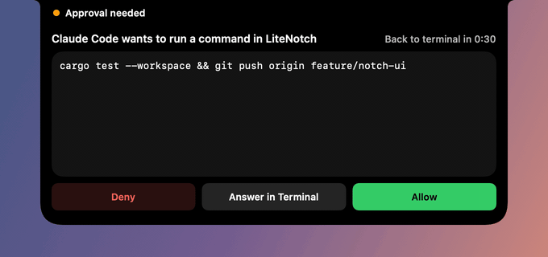
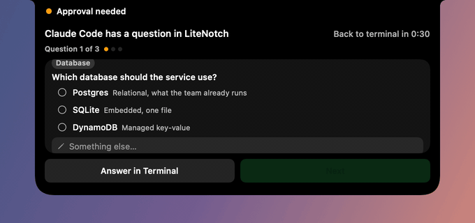
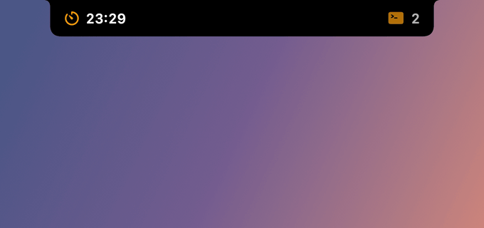
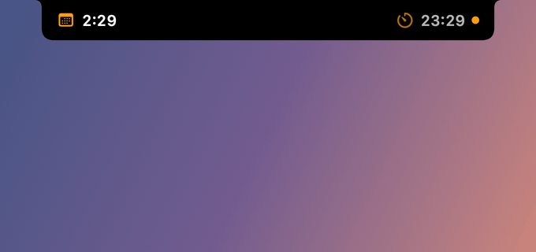

# LiteNotch

LiteNotch turns the notch on your MacBook into a small control centre: what's
playing, a focus timer, your next meeting, your clipboard history,
notifications, and, if you code with an AI agent (Claude Code, Codex, Gemini
CLI or Antigravity), its sessions, approvals and questions. Move the pointer onto the notch to open it; move away to
close it.


> **Early beta** for Apple silicon Macs on macOS 14 or later. It uses about
> 15 MB of memory and under 0.5 % CPU while idle, and the app is 7 MB.

## Install

### With Homebrew

Recent Homebrew (7 and later) loads casks from a third-party tap only after
you trust it. Do this once; without it `brew install`, `brew upgrade` and
`brew info` stop with "Refusing to load cask … from untrusted tap":

```sh
brew trust tangnatta/litenotch
```

Then:

```sh
brew install --cask tangnatta/litenotch/litenotch
open -a LiteNotch
```

That is the stable channel. Pre-releases (`-beta`) come from a separate cask;
it replaces the stable one, so uninstall that first
(`brew uninstall --cask litenotch`):

```sh
brew install --cask tangnatta/litenotch/litenotch@beta
```

`brew upgrade` never moves you between channels; to go back to stable,
uninstall the beta cask and install `litenotch` again.

To update to the latest release:

```sh
brew update
brew upgrade --cask litenotch        # beta channel: litenotch@beta
```

Because this beta isn't notarized by Apple, the cask removes macOS's
"downloaded from the internet" flag after installing, so Gatekeeper doesn't
check the app. If you'd rather check it yourself, compare
`shasum -a 256` of the zip with the `.sha256` file on the release page, or
build from source. Older Homebrew versions (before 7.0.16) may print a
warning that the cask's `postflight` is deprecated; that is this step, and it
still works.

Or download the zip from the
[latest release](https://github.com/tangnatta/LiteNotch/releases), drag
**LiteNotch** into **Applications** and open it. The app isn't notarized yet,
so the first time macOS refuses: click **Open Anyway** in **System Settings ›
Privacy & Security**.

On first launch the notch opens once to show you around. LiteNotch has no Dock
icon; quit it from **Settings › General**. **Check for updates** there only
tells you about a new version; it never installs anything.

## What it does

| | |
|---|---|
| [**Coding agents**](#coding-agents) | Claude Code, Codex, Gemini CLI, Antigravity: see every session, allow or deny requests, answer questions. |
| [**Music**](#music) | Artwork and controls for whatever plays, in any app or browser tab. |
| [**Timer**](#timer) | Focus sessions with breaks, a meeting agenda, a plain countdown. |
| [**Calendar**](#calendar) | Your next events with all their details, a reminder and a countdown; add, edit or delete an event. |
| [**Clipboard**](#clipboard) | Everything you copied, searchable, plus a colour picker. |
| [**Inbox**](#inbox-and-keep-awake) | Notifications from LiteNotch, Claude Code, scripts and other apps. |
| [**Keep awake**](#inbox-and-keep-awake) | The cup keeps the Mac awake, with the lid closed if you like. |
| [**Work day**](#work-day) | How far through your working day you are. Off until you turn it on. |

## Coding agents



Connect each agent with **Connect** in **Settings › Agents**, then start a
new session. If LiteNotch isn't running, every agent behaves exactly as before.

| Agent | Sessions and "needs you" | Allow / Deny | Questions | Usage limits |
|---|:---:|:---:|:---:|:---:|
| **Claude Code** | ✓ | ✓ | ✓ | ✓ |
| **Codex** | ✓ | ✓ | | ✓ |
| **Gemini CLI** | ✓ | | | |
| **Antigravity** | ✓ | | | |

Gemini CLI and Antigravity have no hook LiteNotch could answer, so their
requests are still answered in their own window.

- **Permission requests** open the notch with everything Claude is about to
  do, in full: **Allow**, **Deny**, or **Answer in Terminal** to use Claude
  Code's own prompt. A request too long to review here has no **Allow**.
  Unanswered, it goes back to the terminal after two minutes.
- **Questions** from Claude Code show as a form: click an option, tick several,
  type an answer of your own, or step through several questions.



- **Sessions**: every session and what it is doing. A dot in the closed notch
  means one is waiting for you; it goes when you answer, click the session or
  bring its terminal to the front. Clicking a session raises its terminal
  window (the exact tab in Terminal and iTerm2).
- **Usage**: each agent's 5-hour and weekly limits, and Claude Code's tokens
  this week. Codex's appear on their own. For Claude Code's, click **Show
  usage limits**: it adds LiteNotch to Claude Code's status line and keeps the
  one you had. Gemini CLI and Antigravity keep theirs on Google's servers, so
  they have none here.


**Disconnect** in the same place undoes it. More in the
[guide](docs/guide.md#coding-agent-details).

## Music


Artwork, progress and play / pause / skip for whatever is playing: Music,
Spotify or a browser tab. While a song plays, a ring around the artwork in the
closed notch fills up.

## Timer



- **Focus**: work, short break, repeat. A sound plays when a session or a
  break ends.
- **Meeting**: an agenda run item by item, showing when one runs over.
- **Countdown**: click the time and type `25`, `1:30` or `1h 30m`. Any number
  with − and + beside it can be clicked and typed too.

## Calendar


Turn on **Settings › Calendar**. LiteNotch follows the calendars in the
Calendar app (iCloud, Google, Exchange…): your next event on **Home**, a
reminder a few minutes before (it comes through even during a focus session),
a countdown in the closed notch, and a **Pause focus** button when it starts.

A **Calendar** tab (beside the inbox) lists the next two days. Click an event
for everything in it: time, place, link, guests and their answers, notes.
**New event**, **Edit** and **Delete** change your calendar; for a repeating
event only that occurrence. An event with guests opens in Calendar instead,
since changing it sends them an update. Clicking a reminder opens its event. Links in invitations are shown
and can be copied, never opened by LiteNotch.

## Clipboard


Everything you copy, searchable. Click an item to copy it again; **Aa** copies
it without formatting; pin what you want to keep. Password-manager copies are
skipped. The **eyedropper** next to the search box picks a colour from anywhere on screen and copies
it as `#RRGGBB`.

## Inbox and keep awake


The **bell** holds notifications; click one to go where it came from. Other
apps' notifications can be copied in too (**Settings › Notifications**).
Scripts can post here as well:
`litenotch notify "Deploy finished" "main → production"`.

The **cup** keeps the Mac awake. **Settings › Keep awake** sets how long,
whether it stays awake with the lid closed, and a battery level to stop at.

## Work day


Turn on **Settings › Day** and set your hours (10:00–18:00, Monday to
Friday, until you change them). The closed notch shows how far through the day
you are, `-12%` before it starts and `+19%` after it ends, with a sun and moon
or a tree that grows through the day. It is only a number: no bar, no red, no
line telling you to stop.

## The closed notch



When several things run, the closed notch shows the most pressing on the left
and the next, dimmed, on the right. **Settings › Notch** changes the order or
shows one at a time. For a few seconds it can also show a new song, a timer
about to end, a reminder to rest your eyes, or that water or stretch is running low:


## Appearance


**Settings › General** has the theme and accent colour. Under **More options**:
the **Island** style (a capsule inside the menu bar), shrinking the closed
notch, and Liquid Glass on macOS 26. All of them are described in the
[guide](docs/guide.md#appearance).

## Privacy and permissions

Everything stays on your Mac. LiteNotch works without any permission; four
optional features ask macOS for one: other apps' notifications
(Accessibility), raising a session's terminal tab (control of Terminal or
iTerm2), the calendar, and keeping awake with the lid closed (your password,
once each time LiteNotch starts). The only request it makes to the internet is
the update check, and only when you ask for it.
[Details](docs/guide.md#permissions-and-privacy).

## Known limits

- Apple silicon only; not notarized yet.
- macOS forgets the Accessibility permission after every update; **Reset and
  ask again** in **Settings › Notifications** restores it.
- Now playing uses a private macOS interface. If an update breaks it, the
  Music tab stays empty and nothing else is affected.

Found a problem? [Open an issue](https://github.com/tangnatta/LiteNotch/issues).
What changed in each release: [CHANGELOG.md](CHANGELOG.md).

## Build from source

```sh
brew install rustup && rustup default stable   # once
export PATH=/opt/homebrew/opt/rustup/bin:$PATH
scripts/build-app.sh          # → dist/LiteNotch.app
open dist/LiteNotch.app
```

See [CONTRIBUTING.md](CONTRIBUTING.md); [CLAUDE.md](CLAUDE.md) covers the
architecture, tests and release process. `scripts/previews.sh` redraws the
previews on this page from the app's own views.

## Contributors

<a href="https://github.com/tangnatta"></a>
<a href="https://github.com/defmylife"></a>

## License

LiteNotch is free software under the [GNU General Public License v3.0](LICENSE).
You can use, change and share it; if you distribute a modified version, you
must share its source under the same license.
