# LiteNotch

LiteNotch turns the notch on your MacBook into a small control centre: what's
playing, a focus timer, your next meeting, your clipboard history,
notifications, and, if you code with Claude Code, your AI agent's approvals,
questions and usage, all one hover away. It stays out of the way the rest of
the time and uses almost no battery.


> **Early beta.** It works day to day on the developer's Mac, but expect rough
> edges. Apple silicon, macOS 14 or later.

| | LiteNotch |
|---|---|
| App size | 7 MB |
| Memory while idle | 15 MB |
| CPU while idle | under 0.5 % |

## Contents

- [Install](#install)
- [Using the notch](#using-the-notch): [Music](#music) · [Focus timer](#focus-timer) · [Meeting timer](#meeting-timer) · [Countdown](#countdown) · [Clipboard](#clipboard) · [Calendar](#calendar) · [Inbox](#inbox) · [Keep awake](#keep-awake) · [Day progress](#day-progress)
- [Claude Code](#claude-code): [Set up](#set-up) · [Permission requests](#permission-requests) · [Questions](#questions-from-claude) · [Sessions and usage](#sessions-and-usage) · [Claude Desktop](#claude-desktop) · [Scripts](#post-from-scripts)
- [Make it yours](#make-it-yours): [Closed notch](#what-the-closed-notch-shows) · [Heads-ups](#heads-ups-and-reminders) · [Island](#island) · [Appearance](#appearance) · [Settings](#settings) · [Updates](#updates)
- [What macOS may ask for](#what-macos-may-ask-for) · [Privacy](#privacy) · [Known limits](#known-limits-of-this-beta) · [Build from source](#build-from-source) · [Contributors](#contributors) · [License](#license)

## Install

### With Homebrew

Recent Homebrew (7 and later) loads casks from a third-party tap only after
you trust it. Do this once; without it `brew install`, `brew upgrade` and
`brew info` stop with "Refusing to load cask … from untrusted tap":

```sh
brew trust tangnatta/litenotch
```

Then:

```sh
brew install --cask tangnatta/litenotch/litenotch
open -a LiteNotch
```

That is the stable channel. Pre-releases (`-beta`) come from a separate cask;
it replaces the stable one, so uninstall that first
(`brew uninstall --cask litenotch`):

```sh
brew install --cask tangnatta/litenotch/litenotch@beta
```

`brew upgrade` never moves you between channels; to go back to stable,
uninstall the beta cask and install `litenotch` again.

To update to the latest release:

```sh
brew update
brew upgrade --cask litenotch        # beta channel: litenotch@beta
```

`brew update` fetches the newest version from the tap first; without it,
Homebrew may still think the version you have is the latest. After an
update, macOS forgets LiteNotch's Accessibility permission: if you read other
apps' notifications, use **Reset and ask again** in the inbox once.

Uninstall with `brew uninstall --cask litenotch` (add `--zap` to also delete
settings and history).

Because this beta isn't notarized by Apple, the cask removes macOS's
"downloaded from the internet" flag after installing, so Gatekeeper doesn't
check the app. If you'd rather check it yourself, compare
`shasum -a 256` of the zip with the `.sha256` file on the release page, or
build from source. Older Homebrew versions (before 7.0.16) may print a
warning that the cask's `postflight` is deprecated; that is this step, and it
still works.

### Download

1. Download `LiteNotch-<version>-arm64.zip` from the
   [latest release](https://github.com/tangnatta/LiteNotch/releases).
2. Unzip it and drag **LiteNotch** into **Applications**.
3. Open it. The app isn't notarized by Apple yet, so the first time macOS
   refuses. Go to **System Settings › Privacy & Security**, scroll down and
   click **Open Anyway** next to LiteNotch. After that it opens normally.
   (Or, in Terminal: `xattr -dr com.apple.quarantine /Applications/LiteNotch.app`.)

LiteNotch has no Dock icon. It lives in the notch; quit it from
**Settings › General**.

## Using the notch

**Open the notch** by moving the pointer onto it, or by clicking it. Move
away or click anywhere else to close it. Tabs on the left side of the bar
switch views; the icons on the right are quick controls: the **cup** (keep
awake), the **bell** (inbox) and the **gear** (settings). **Home** shows
everything at a glance: what's playing, your timer, your next calendar
event, your AI sessions and the latest notification. Click any of them to go
there.

The previews on this page are drawn by the app's own screens with sample
data, a second at a time. They leave out motion: in the app the notch
springs open, the bars move with the music and long titles scroll.

### Music


Artwork, progress and play / pause / skip for whatever is playing, in any
app: Music, Spotify, or a browser tab. While something plays, the closed
notch shows its artwork inside a ring that fills as the song plays (a rounded
square, or a circle in the Island style; turn it off in **Settings › Music**),
and a new song shows its title for a moment.

### Focus timer


**Focus** is a pomodoro: work, short break, repeat. The closed notch counts
down, with a timer icon while you focus and a leaf during a break. A sound
plays when a session or a break ends (choose it, or turn it off, in
**Settings › Timer**).

### Meeting timer

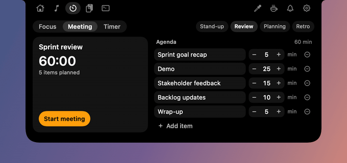

**Meeting** runs an agenda item by item (stand-up, sprint review, planning,
retro, or your own) and shows when an item runs over.

### Countdown

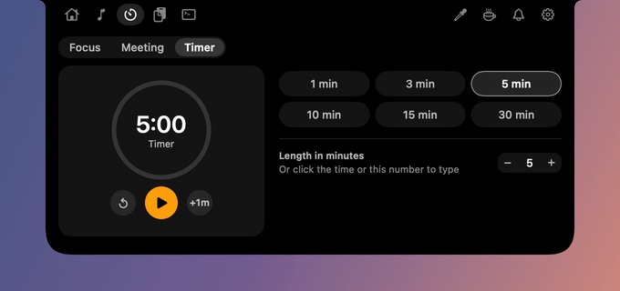

**Timer** is a plain countdown: click the time in the circle and type `25`,
`1:30` or `1h 30m`. Any `− 12 +` number (an agenda item's minutes, a timer
length) can be clicked and typed too.

### Clipboard

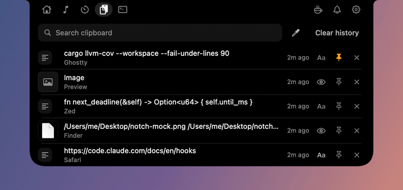

Everything you copy, searchable. Click an item to copy it again. Text copied
with formatting keeps it; the **Aa** button copies it as plain text. Images
and files show a preview. Pin what you want to keep. Password-manager copies
are skipped. The **eyedropper** in the bar picks a colour from anywhere on
screen: it's copied as `#RRGGBB`, and recent colours sit at the top.

### Calendar

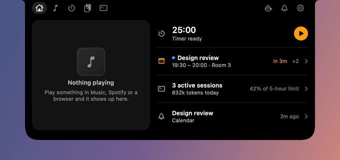

Turn on **Settings › Calendar › Show calendar events** and LiteNotch follows
the calendars you have in the Calendar app (iCloud, Google, Exchange, and so
on):

- **Home** shows your next event, when it starts and where. Click it to open
  Calendar.
- A notification appears a few minutes before an event (5 by default; set
  it from 0 to 60) and again when it starts. These come through even during
  a focus session.
- From the reminder until the start, the closed notch counts down to the
  event.

All-day events, cancelled events and invitations you declined are left out.
LiteNotch only reads your calendars; it never changes them.

### Inbox


Notifications from LiteNotch, Claude Code, and, if you allow it, other apps
(the **bell**). Click one to open where it came from.

### Keep awake

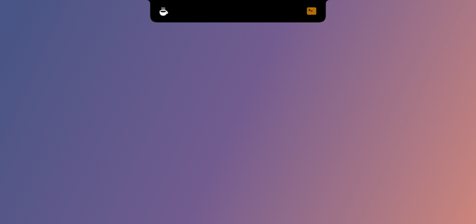

The **cup** keeps the Mac awake. In **Settings › Keep awake**:

- **With the lid closed** is a saved choice. Set it once and every time you
  turn keep awake on, with the cup or from Settings, it stays awake with the
  lid shut too, until you change it. It asks for your password once each time
  LiteNotch is started, and turns itself off when LiteNotch quits.
- **Stop keeping awake below** is one battery limit for every mode, lid open
  or closed. Set it to 0 % for no limit at all.
- A timer for how long.

### Day progress


Off by default. Turn it on in **Settings › Day** and set your office hours
(10:00 to 18:00, Monday to Friday, until you change them). On a working day
the closed notch can show how far through the day you are: `-12%` before it
starts, `37%` during, `+19%` after the end. It sits last in the order, so
anything more pressing comes first. On **Home** the big card shows the day
too, with a short line under the number, and gives way to the music while
something plays (**Settings › Home** can pin either one).

The **Icon** choice is the sun and moon by the time of day, or a tree that
grows through it: a seed before you start, two leaves, a sapling, a young
tree, and at the end of the day a full tree. It never withers.

It is only a number. There is no bar, no colour that turns red and no line
that tells you to stop: what you do before and after work is your own.

## Claude Code

LiteNotch puts Claude Code in the notch: its permission requests, its
questions and every session's state, so you can answer without finding the
right terminal window.

### Set up

1. Open **Agents** and click **Connect Claude Code**, or run
   `litenotch hooks install`.
2. Start a new Claude Code session. It appears under **Agents**, and its
   requests open the notch.

Sessions that were already running pick this up at their next prompt. If
LiteNotch isn't running, Claude Code behaves exactly as before. **Disconnect**
undoes it (a backup of your settings is kept as
`settings.json.litenotch-backup`).

Only one copy of LiteNotch should be connected. If you have run other
copies (a test build, the app from a different folder), LiteNotch tells you
at start and **Settings › Agents** offers **Remove them**; connecting also
replaces any other copy's hooks.

### Permission requests


When Claude Code wants to run a command, edit a file or use a tool, the notch
opens with everything it is about to do, shown in full, and three choices:
**Allow**, **Deny**, or **Answer in Terminal** (Claude Code then shows its
own prompt). **Allow** stays inert for a moment after the request appears so
a click already in flight can't approve something you haven't read. A request
too long to review in the notch has no **Allow** at all; answer it in the
terminal. An unanswered request goes back to the terminal after two minutes.

### Questions from Claude

When Claude asks *you* something (Claude Code's question tool), the notch
shows the question itself with a layout that fits its kind, and sends your
answer back. **Answer in Terminal** is always there.

| Kind of question | What you see |
|---|---|
| **Single choice** | One line per option, with its note. Click one and it is sent. |
| **Multiple choice** | Checkboxes and "Choose any", plus **Add your own…** for answers of your own, as many as you like. **Send answer** counts what you picked. |
| **Open question** | A roomy box to type in, then **Send answer** (or Return). |
| **Several questions** | One at a time with "Question 2 of 3" and a dot for each, **Back** and **Next**, and **Send answer** on the last. |

Every question also has a line for an answer of your own. In a single-choice question it replaces the option you picked; in a multiple-choice one press Return (or **+**) to add it as another answer and type the next, as many as you like, and remove one with its **×**.

**Single choice**

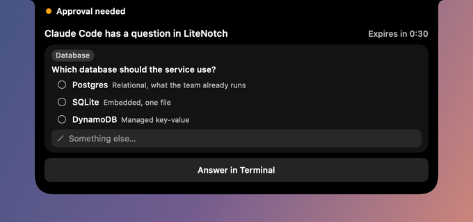

**Multiple choice**


**Open question**

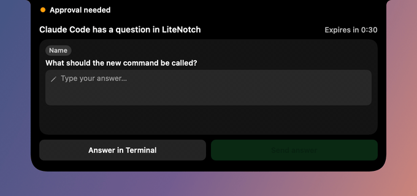

**Several questions**


### Sessions and usage


Every session and what it is doing, and a small dot in the closed notch while
one is waiting for you. The dot goes when you click that session, answer it,
or bring its terminal window to the front. Clicking a session brings its
terminal window to the front (the exact window and tab in Terminal and iTerm2,
the app in other terminals).

To also see your **usage limits** and a 7-day summary, click **Show usage
limits** in **Settings › Agents**. It makes LiteNotch your Claude Code status
line and keeps the one you already have; **Stop showing usage limits** gives
it back.

### Claude Desktop

LiteNotch listens to Claude Code's hooks, which live in
`~/.claude/settings.json`. Claude Code sessions started from the Claude
desktop app's Code tab use the same file, so they should appear here too and
bring that app forward when clicked. This has not been tried yet. Ordinary
chats in Claude Desktop have no hooks, so LiteNotch can't see them.

### Post from scripts

The command-line tool can post to the notch from scripts too:

```sh
litenotch notify "Deploy finished" "main → production" --priority high --source ci
```

## Make it yours

### What the closed notch shows


When several things are running, the closed notch shows the most pressing
one on the left and the next one, dimmed, on the right. Out of the box the
order is: a meeting agenda you are running, an event about to start, a
countdown timer, a focus session, music, keep awake, a working agent. So
with a focus session running and a meeting five minutes away, you see the
countdown to the meeting first and your focus time beside it.

- A permission request or a notification still takes the whole notch while
  it is up.
- A small dot appears while a Claude Code session is waiting for you. It
  goes when you click that session in the notch, answer it, or bring its
  terminal window to the front.
- When a meeting starts during a focus session, its notification has a
  **Pause focus** button.
- During a focus session only what cannot wait comes through: permission
  requests, meeting reminders, finished timers and the last usage warning.
  The rest is delivered at the break.

Change any of this in **Settings › Notch**: reorder the list, switch an
activity off to keep it on Home only, show one activity instead of two, or
turn the dot off. The preview at the top shows the result for a few typical
situations.

### Heads-ups and reminders


For a few seconds the closed notch can show one thing, then go back to what
it was showing. These never land in the inbox. All are set in
**Settings › Timer** (the song one in **Settings › Music**; eye break,
water and stretch in **Settings › Day**):

- **Heads-up before it ends:** a focus session or countdown shows the time
  left 1, 3, 5 or 10 minutes before it ends.
- **A new song:** its title, when the track changes.
- **A line after a break:** a short line of encouragement when a break
  ends.
- **Eye break** (off unless you turn it on): every few minutes at the
  screen, a blinking face and "Look away".
- **Water** and **Stretch** (off unless you turn them on): two gauges that
  run down while you're at the Mac. When one runs empty the notch says so
  once. Fill water with **Drank**: a 200 ml cup fills half the tank, and a
  cup right after another counts as 50 ml, so spacing them out (15 minutes)
  counts more. Fill stretch by
  tapping **Stretch** once per movement. Show them on Home with
  **Settings › Home › Big card: Body** (water alone, or water and stretch
  side by side). **Auto** shows the gauges when one is low (below 20 %),
  a new song for a minute, the gauges again below 50 %, then the day or
  music. They replace the older Move reminder; its setting carries
  over.

These count only the minutes you are at the Mac, whatever the focus timer is
doing: the screen on and unlocked, and the lid open. The eye break starts over
and the gauges stand still when you lock the screen, the Mac sleeps, or you
close the lid (also when keep awake holds a closed-lid Mac awake, since nobody
can see the screen then). With an external display connected the lid does not
matter.

Reminders pause while the screen is locked or asleep.

### Island

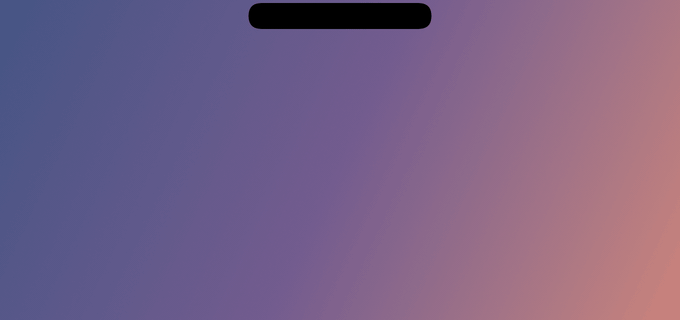

Choose **Island** in **Settings › General › Notch** for a small capsule that
sits inside the menu bar instead of hanging from the notch. Everything works
as before: the capsule shows what's running (one activity, or two side by
side), notifications drop just below it, and the panel opens beneath it with
the same tabs. On a Mac with a notch the capsule keeps clear of the camera;
on a display without one it is a single row across the middle. **Attached**,
the original look, stays the default.

### Appearance


All under **Settings › General**. The defaults are the original look.

| Setting | Choices |
|---|---|
| **Theme** | System, Dark or Light, for the open panel. |
| **Accent** | The accent colour you chose in macOS (it follows when you change it there), plain black/white to match the theme, one of four presets, or your own: the rainbow swatch opens a strip to drag along, with an eyedropper beside it to take a colour from the screen. |
| **Notch** | **Attached** hangs from the top edge in the notch's own shape. **Island** is a small capsule inside the menu bar, with notifications and the open panel hanging just below it; it suits a Mac or an external display without a notch (see [Island](#island)). Without a notch, both styles show what's running in one row across the middle, since there is no camera to leave room for. |
| **Closed notch** | **Always dark**, or **Match theme** so the closed notch and notifications turn white in the light theme. Offered only on a display without a notch: around a real notch, which is always black, it stays dark. |
| **Shrink** | On a Mac with a notch: **Always** keeps the sides of the notch clear while it is closed (peeks, notifications and permission requests still show). On a display without a notch: **Default** keeps the closed notch as it is. **When empty** shrinks it to a thin strip at the top edge while it has nothing to show. **Always** keeps it a strip whenever it is closed, except for the few seconds of a new song or a timer about to end. |
| **Panel** | **Solid**, or **Glass** to draw the open panel with macOS 26's Liquid Glass. Approval requests are always shown on the solid panel so they stay readable. |

### Settings

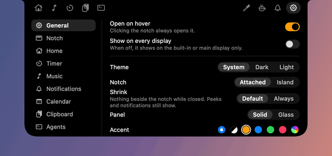

The **gear** opens Settings: everything adjustable, by feature, one page each.

### Updates

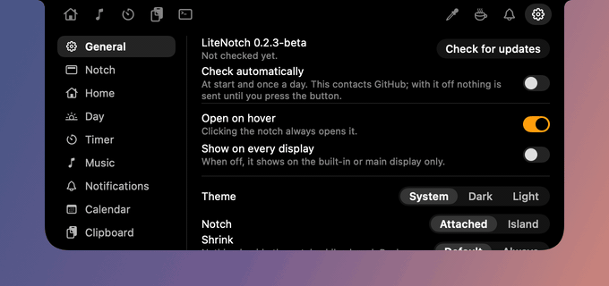

**Settings › General** starts with the version you are running and a **Check
for updates** button. If there is a newer one it says so and offers **Copy
update command**, then paste it in Terminal if you installed with Homebrew
(`brew update && brew upgrade --cask litenotch`), or **Release page** to
download it. LiteNotch only tells you; it never updates itself. **Check
automatically** looks at start and once a day and posts a notice when a new
version appears; it is off unless you turn it on.

## What macOS may ask for

LiteNotch works without any permission. Four optional features need one:

- **Other apps' notifications:** turn on in **Inbox**, then allow LiteNotch
  in **System Settings › Privacy & Security › Accessibility**. macOS forgets
  this permission when LiteNotch is updated; use **Reset and ask again** in
  the inbox to restore it.
- **Going to a session's own terminal window:** the first time you click a
  Claude Code session, macOS asks whether LiteNotch may control Terminal (or
  iTerm2). Allow it and the click raises that session's window and tab. If
  you don't, the click still brings the terminal app forward.
- **Calendar:** the first time you turn it on, macOS asks whether LiteNotch
  may see your calendars. If you said no, allow it under **System Settings ›
  Privacy & Security › Calendars** (choose **Full Access**; LiteNotch only
  reads). Like Accessibility, macOS may ask again after an update.
- **Keep awake with the lid closed:** asks for your administrator password
  the first time you turn it on. After that you can normally switch it off
  and on without typing it again until you quit LiteNotch. The mode turns
  itself off after 12 hours, and if macOS stops honouring it for any reason
  LiteNotch tells you and asks for the password the next time.

## Privacy

Everything stays on your Mac. Clipboard history is kept in memory unless you
turn on **Keep on restart**. LiteNotch counts how often each feature is used
(never what you copy, play or type) so you can see the counts in
**Settings › Privacy**; nothing is sent anywhere.

The one exception is the update check. When you press **Check for updates**
in **Settings › General** (or turn on **Check automatically**, which is off
until you do), LiteNotch asks GitHub for the newest release, an ordinary
request to `api.github.com`. It sends no version, identifier or anything about
you or your Mac, and it never downloads or installs anything by itself.

Now playing uses a private macOS interface (the same approach other notch
apps use). If a macOS update breaks it, the Music tab stays empty and
nothing else is affected.

## Known limits of this beta

- Apple silicon only; not notarized yet.
- Other apps' notifications are read from the banners on screen, so they
  need the Accessibility permission, which resets on each update.
- Closed-lid mode needs your password once each time LiteNotch is started.

Found a problem? [Open an issue](https://github.com/tangnatta/LiteNotch/issues).

## Build from source

```sh
brew install rustup && rustup default stable   # once
export PATH=/opt/homebrew/opt/rustup/bin:$PATH
scripts/build-app.sh          # → dist/LiteNotch.app
open dist/LiteNotch.app
```

`scripts/previews.sh` redraws the previews on this page (needs `ffmpeg`).

Contributing: see [CONTRIBUTING.md](CONTRIBUTING.md). Developers: [CLAUDE.md](CLAUDE.md) covers the architecture, commands,
tests, performance budgets (`scripts/bench.sh`) and the release process.
Tests: `cargo test --workspace` and `swift test --package-path macos`.

## Contributors

<a href="https://github.com/tangnatta"></a>
<a href="https://github.com/defmylife">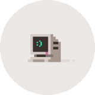</a>

## License

LiteNotch is free software under the [GNU General Public License v3.0](LICENSE).
You can use, change and share it; if you distribute a modified version, you
must share its source under the same license.
